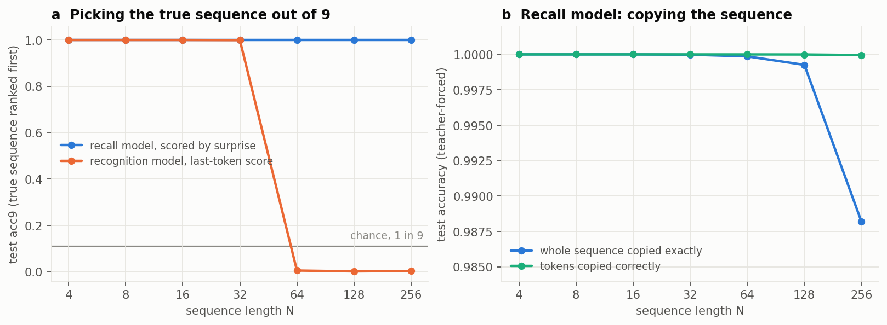
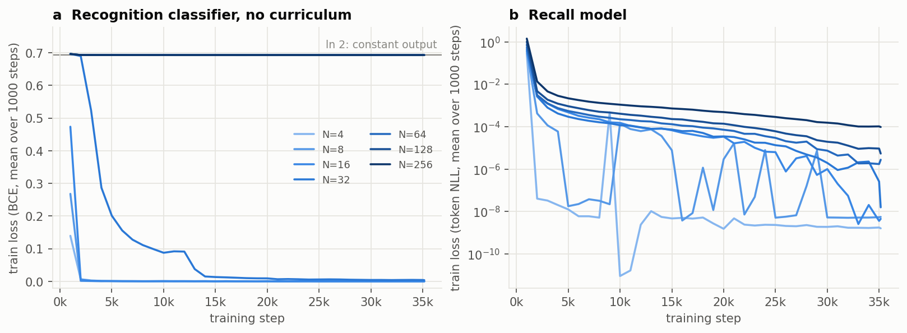
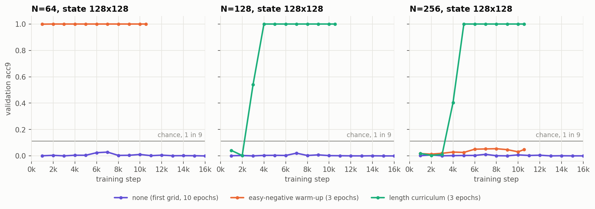
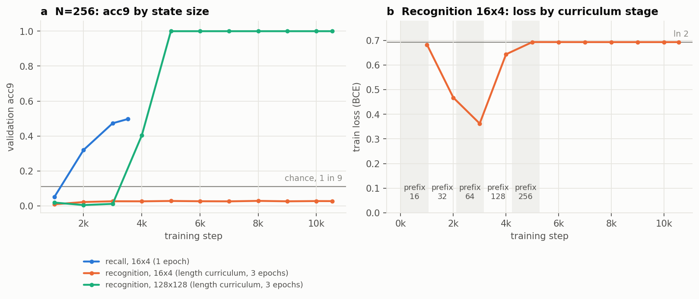
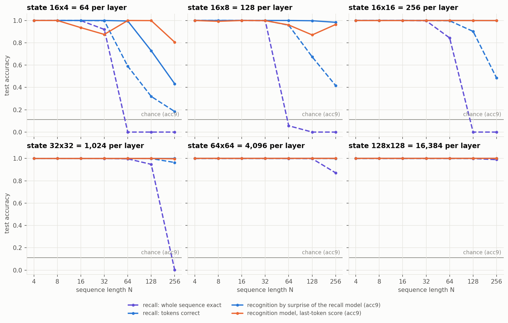
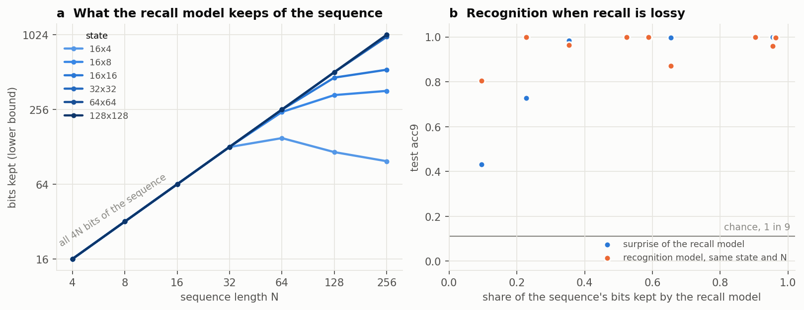
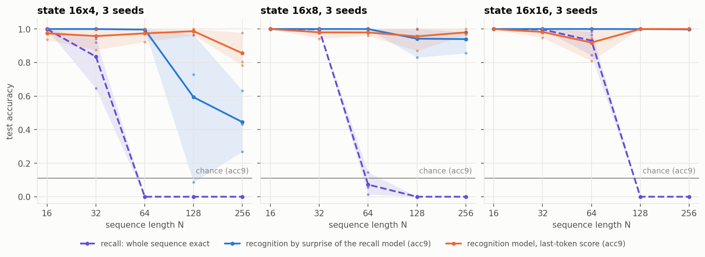
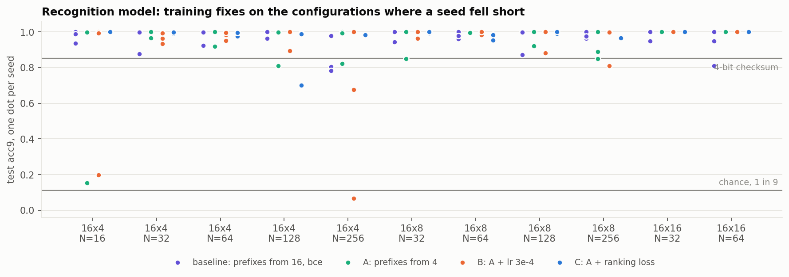
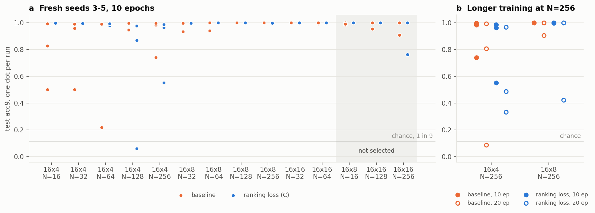
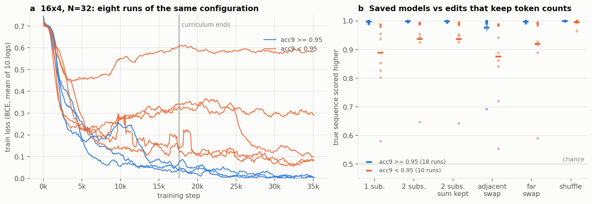

# Recall vs recognition memory in a small Gated DeltaNet-2

Updated 2026-11-09 12:00. This report covers every result: the first grid (14 runs), two rounds of smoke tests (7 runs), a 0.1-epoch pipeline check (2 runs), the state-size sweep (84 runs), seeds 1–2 for its three smallest states (60 runs), a test of three training fixes for the recognition model (99 runs), fresh seeds, longer training and a reproduction check (98 runs), a diagnosis of failed recognition runs (28 instrumented runs), a test of benchmark-like negatives from the first step (72 runs), lengths 512 and 1,024 (36 runs and 2 smoke runs), and a keyed benchmark with up to 1,024 sequences per sample (24 runs and 4 smoke runs).

Figures are generated by [make_figures.py](make_figures.py) and checksum baselines by [checksum_baseline.py](checksum_baseline.py), from the result files listed at the end.

## Summary

- **Hypothesis.** A memory doesn't have to reproduce past experience. It can instead recognise whether an input is consistent with it, using low surprise as the familiarity signal. Checking is easier than generating, so recognition should need less capacity than recall.
- **In principle, recognition on this benchmark needs a few bits; recall needs 4N.** A memory that stores only an 8-bit checksum of the sequence picks the true sequence out of 9 in 96.5% of test samples, at every length. Recall at N=256 needs all 1,024 bits.
- **In the trained models, one state recognises long after it stops recalling.** The sweep shrinks the GDN-2 state from 128×128 to 16×4 per layer.
  - Recall breaks early. At 16×16 and N=256, no sequence is copied exactly and only 48% of tokens are right; the model keeps at least 536 of the 1,024 bits.
  - Recognition holds. With the same state and length, the true sequence is still ranked first out of 9 in 99.9% of samples by the recall model's surprise, and in 100% by the recognition model.
  - **Longest length per state** (experiment 8, lengths up to 1,024). Greedy decoding copies the sequence exactly (≥ 90% of samples) up to N = 32, 32, 64, 128, 128 and 512, from 16×4 to 128×128. Recognition (acc9 ≥ 0.99) has no limit in this range: every state has a run that passes at N=1,024, the longest length tested, with one readout or the other. It is the recognition model at 16×4 and 16×8 (surprise wasn't run that far there), surprise at 16×16 and 32×32 (the recognition model's best is 0.969 and 0.989), and both from 64×64 up. That is at least 32 times the copy length at 16×4 and 16×8. At N ≥ 512 the recognition model trained on fresh negatives, at N ≤ 256 on the stored ones, so its numbers across that boundary are not a clean comparison. Those best runs are not typical at small states: at 16×4 only 1 of 3 passes at N=1,024, and the median run passes up to N=128.
  - Recall stays near-perfect only up to roughly N = 16 to 32 at the three smallest states (16×4 to 16×16). With seed 0, recognition by either readout stays above 0.96 at N=256 down to 16×8, though the recognition model dips to 0.87 at 16×8 and N=128. At 16×16 and above, it stays at 0.997 or better.
- **With many keyed sequences, recognition is cheaper by a constant factor, not exponentially** (experiment 9). The memory holds N (key, sequence) pairs of 8 tokens, in a GDN-2 with d_model 32, 2 layers and states 4×4 to 32×32 per layer.
  - The median seed reconstructs 1, 1, 4 and 8 pairs (exact copy ≥ 0.5) and recognises 2, 4, 8 and 64 (acc9 ≥ 0.5). Both grow about in proportion to the state.
  - A constant gap is what information theory allows. Recognising each of N keyed items with error ε takes about N·log₂(1/ε) bits, not O(log N): a 12-bit checksum per key reaches 0.997 at every N, against 32 bits per pair to reconstruct.
  - From 16×16 up, the recall model's surprise recognises better than the recognition model, as at larger states with one sequence. At 32×32 and N=16 it copies only 13–40% of sequences exactly but scores 0.95–0.98.
- **A memory trained to recognise beats one trained to recall only at the smallest state.** These numbers compare the recall model's surprise with the dedicated recognition model (last-token score).
  - At 16×4 and N=128/256, where the recall model keeps only 10–23% of the bits, the recognition model scores 0.984/0.882 (mean of 6 runs). Surprise scores 0.593/0.445 (mean of 3 runs).
  - At N=256 the recognition model's worst run (0.741) beats surprise's best (0.633). At N=128 the ranges overlap only at the top: surprise's runs span 0.086–0.966, the recognition model's 0.947–1.000.
  - At 16×8 they are about even: 0.956/0.980 against 0.943/0.940.
  - At 16×16 and larger, both are at 0.997–1.000 at long lengths.
  - The recognition model also has occasional training failures at N = 16–64, even at states that handle N=256 perfectly.
- **The recognition model trains with a length curriculum plus an easy-negative warm-up.** With neither (experiment 1), the last-token readout failed from N=64 up even at full state size: the loss stayed at ln 2. In short smoke runs the warm-up alone fixed N=64 but not N=256 (experiment 2, whose round-1 code version is uncertain). The length curriculum was never run without the warm-up, so how much each part matters is not known. With both, all 72 recognition runs of the sweep and the seed runs trained, though some seeds stalled short of their best.
- **At small states, training outcomes are not reproducible** (experiment 5). The same code and seed reached 0.871 in the sweep and 0.058 in a rerun on a different GPU model. That is consistent with GPU kernels that aren't bit-identical, with small early differences deciding whether a run learns or collapses, but no run has been repeated on the same GPU model, so the cause isn't measured. Every small-state result is one draw from a wide, two-humped distribution, so matching seed numbers doesn't pair runs.
- **Failed recognition runs learn the right kind of comparison, but not precisely enough** (experiment 6).
  - They compare candidates token by token, using order: they detect shuffles and swaps. But they catch only 80–90% of single changes, evenly across positions and change sizes.
  - Whether a run becomes precise is decided during the curriculum, while easy negatives are still available. After that it stays on a plateau.
  - Mixing the benchmark's 1–2-token negatives in from the first step doesn't help (experiment 7). With a 25% share, 7 of 24 runs fail, the same as without it. With 50%, 11 of 24 fail.
- **A ranking loss helps a little up to N=128, not significantly, and not at N=256** (experiments 4 and 5). The model learns to score the true sequence above a corrupted copy, keeping the same last-token readout, and the curriculum starts at length 4.
  - Up to N=128, runs below 0.95 drop from 8 to 1, and mean acc9 rises from 0.968 to 0.982.
  - This is a hypothesis, not a result. The configurations were chosen because a baseline run had fallen short, which favours any fix through regression to the mean, and the N ≤ 128 cut was made after seeing the results.
  - Across all 11 configurations, no fix beats the baseline on average (C 0.940 against 0.959).
  - At N=256 with 16×4 and 16×8 states, some ranking-loss runs learn too slowly and end lower than with the old training (16×4 mean 0.582 against 0.855).
  - On fresh seeds (experiment 5), the ranking loss has 2 runs below 0.95 of 33 up to N=128, against the baseline's 7 (p = 0.07, one-sided Fisher). It also collapses sometimes (0.060 at 16×4 N=128). At N=256 it is again worse (0.919 against 0.959).
  - There is no evidence that training twice as long, with more curriculum time on long prefixes, helps at N=256; it may hurt (6 of 12 runs below 0.95, against 2 of 12; one-sided Fisher p = 0.10). The two changes were made together.

## Benchmark

[`irodkin/recognition-memory`](https://huggingface.co/datasets/irodkin/recognition-memory) (public). Generated by [benchmark/generate.py](../benchmark/generate.py) and checked by [benchmark/test_dataset.py](../benchmark/test_dataset.py).

| | |
|---|---|
| Tokens | uniform i.i.d. over a vocabulary of 16 (4 bits per token) |
| Subsets | `N4_V16`, `N8_V16`, …, `N1024_V16` (lengths 4–1,024, powers of 2; 512 and 1,024 added for experiment 8) |
| Splits | train 900k, validation 50k, test 100k sequences per subset |
| Negatives | 8 corrupted copies per sequence. One random position is always changed; each other position changes with probability 1/(N−1). A change adds a uniform shift of 1–15 mod 16, so the new token is uniform over the other 15 values. |
| Changes per copy | 1 + Binomial(N−1, 1/(N−1)); mean 2.0 at every N |

A corrupted copy usually differs from its source in only 1–2 positions.

How much a memory must hold, in theory:
- **Recall** needs all 4N bits (1,024 bits at N=256).
- **Recognition** needs far less, because the negatives are low-weight changes, and a checksum detects those.
  - The sum of the tokens mod 16 (4 bits) changes under every single substitution, since each change is a nonzero shift. It misses a double substitution only when the two shifts cancel, about 1 time in 15.
  - Adding a second sum with odd position weights (8 bits in all) also catches most of those.
  - A memory that keeps only the checksum, and accepts candidates whose checksum matches, scores the acc9 below on the test sets ([checksum_baseline.py](checksum_baseline.py); a tie for the top score shares the win):

| N | 4-bit checksum | 8-bit checksum |
|---|---|---|
| 4 | 0.834 | 0.979 |
| 8 | 0.845 | 0.975 |
| 16 | 0.848 | 0.970 |
| 32 | 0.849 | 0.967 |
| 64 | 0.851 | 0.966 |
| 128 | 0.851 | 0.966 |
| 256 | 0.852 | 0.965 |

Recognition accuracy here doesn't depend on N at all, because the information needed stays fixed while recall's grows by 4 bits per token. So the hypothesis holds in principle, by a wide margin. The experimental question is whether a trained memory finds a code like this.

A GDN-2 state could in principle hold one. A fixed linear projection of the token embeddings, summed over the sequence, is a real-valued checksum, and a delta-rule state can accumulate such a sum. The last-token readout can then compare it with the same sum over the candidate. Per-token surprise can't use a global checksum: it can only exploit what the memory knows about each position separately.

## Model, objectives and metrics

### Network

[experiments/train_gdn2.py](../experiments/train_gdn2.py):

```
Embedding(18, 128) → 2 × [RMSNorm → GatedDeltaNet2 → +res → RMSNorm → GatedMLP(ratio 4) → +res] → RMSNorm
   ├─ lm_head:  Linear(128 → 16)   next-token logits
   └─ cls_head: Linear(128 → 1)    familiarity score
```

- **Attention layer.** `fla.layers.GatedDeltaNet2` (flash-linear-attention 0.5.2), hidden size 128, one head, short convolution on.
- **Memory size.** Per layer the recurrent state is a d_k × d_v matrix, where d_k = `head_dim` and d_v = `head_dim · expand_v`. The default (d_k = d_v = 128) gives 16,384 numbers per layer, and the model has 729,859 parameters. The 16×4 variant has 416,243.
- **Input.** `[BOS] sequence [SEP] candidate`, length 2N+2. The sequence is presented in context, and only the recurrent state can carry it forward to the candidate.

### How familiarity is scored

The two models use the same network but different readouts and training.

| | Recall model (`--objective lm`) | Recognition model (`--objective cls`) |
|---|---|---|
| Trained to | predict every candidate token, with the candidate = the sequence (copy task) | output one logit at the **last token's last hidden state**: "candidate = sequence?" |
| Training signal | cross-entropy on N tokens per sample | binary cross-entropy, one label per sample; 50% positives, 50% one of the 8 corrupted copies |
| Familiarity score of a candidate | **−surprise** = Σⱼ log p(candⱼ \| sequence, cand<ⱼ), summed over the N candidate positions | the logit from `cls_head` |

At test time each sequence is scored against itself and its 8 corrupted copies:

- **acc9.** The share of samples where the true sequence gets the strictly highest score. Chance is 1/9 ≈ 0.111.
  - From experiment 2 on, a tie for the top score counts as 1/(number of candidates tied), so a constant score gives 1/9.
  - In experiment 1, ties counted as failures, so a constant score gave about 0. Experiment 1 also read the scores out in bf16, which makes ties likely.
- **pairwise.** The share of (true, corrupted) pairs where the true sequence scores higher; a tie counts as ½. Chance is 0.5.
- **recall_token_acc / recall_exact** (recall model only). Teacher-forced argmax accuracy on the true copy, per token and for the whole sequence. For a copy task this matches greedy decoding.
- **balanced_acc** (recognition model only). Mean of the true-positive and true-negative rates with the logit thresholded at 0, over the 9 candidates.

### Training

- **Optimiser.** AdamW with lr 1e-3, betas (0.9, 0.95) and weight decay 0.1 (none on embeddings, norms or biases). 500 warmup steps, then cosine decay to 10% of lr. Batch size 256, bf16 autocast, gradient clipping at 1.0.
- **Length.** One epoch is 3,516 steps; 10 epochs is 35,156.
- **Data.** The whole train split sits on the GPU and is reshuffled every epoch. At N ≥ 512 only the sequences do (experiment 8).
- **Evaluation.** Every 1,000 steps on the first 10k validation samples. At the end, on the full 100k test split (the first 10k in smoke runs).
- **Seeds.** One seed (0) in experiments 1 and 2 and the first pass of experiment 3. Later runs add seeds, listed in each section.

## Experiment 1: full-size model at all lengths

**Question.** Does the full-size model recall and recognise sequences of every length?

**Setup.** d_k = d_v = 128, 10 epochs, seed 0, both objectives at N = 4…256: 14 runs. They ran through the router on mbz_nlp, mbz_nlp2, mbz_nlp3 and mbz_nlp2.07 (RTX 6000 Ada / RTX 5880 Ada). Runs took 7–31 minutes each. Results are in `results/gdn2/`.

**Test results (100k samples):**

| N | recall: exact copy | recall: token acc | recall: acc9 (surprise) | recognition: acc9 | recognition: pairwise | recognition: balanced acc |
|---|---|---|---|---|---|---|
| 4 | 1.0000 | 1.0000 | 1.0000 | 1.0000 | 1.0000 | 1.0000 |
| 8 | 1.0000 | 1.0000 | 1.0000 | 1.0000 | 1.0000 | 1.0000 |
| 16 | 1.0000 | 1.0000 | 1.0000 | 1.0000 | 1.0000 | 1.0000 |
| 32 | 1.0000 | 1.0000 | 1.0000 | 0.9993 | 0.9999 | 0.9994 |
| 64 | 0.9999 | 1.0000 | 1.0000 | 0.0052 | 0.5005 | 0.5000 |
| 128 | 0.9993 | 1.0000 | 1.0000 | 0.0014 | 0.5001 | 0.5000 |
| 256 | 0.9882 | 1.0000 | 1.0000 | 0.0033 | 0.5008 | 0.5000 |



*Figure 1. (a) acc9 by length: the recall model scored by surprise (blue) and the recognition classifier (orange). Recognition values at N ≥ 64 fall below 1/9 because this experiment counted ties as failures. (b) Recall-model copy accuracy; note the zoomed y-axis.*



*Figure 2. Training loss, averaged over each 1,000-step window. (a) For N ≥ 64 the classifier sits at ln 2 (a constant output) from the first eval to the end. N=32 stays on that plateau for about 2,000 steps, then escapes. (b) The recall model drops below 1e-2 within 2,000 steps at every length.*

**What this shows:**
- **Recall is easy at this state size.** Token accuracy is 1.000 everywhere. Exact-copy accuracy only begins to slip at N=256 (0.988): about 1 in 85 sequences has a wrong token (token accuracy still rounds to 1.0000). Surprise ranks the true sequence first in every test sample at every length.
- **The recognition classifier failed to train at N ≥ 64; it did not run out of memory.** Its gradient norm decayed to about 0.03, and it put out the same score for every input. The network that failed here learns recall at the same lengths in under 1,000 steps. The label is the problem: one bit per sample, about a difference in 2 tokens out of 64–256.
- **This setup can't separate the two kinds of memory.** At N=256 the content is 1,024 bits and the state has 16k numbers per layer. The state has to become the bottleneck, which is experiment 3.

**Caveats:**
- Single seed.
- Ties counted as failures, and scores were read out in bf16. Both were fixed for later experiments.
- The two N=8 runs were reused from an earlier sync of the code (`files_sha256` 52e31b… versus 41772b… for the rest). The difference was the eval batch-size cap, which only changes evaluation. Experiment 3 reruns every configuration from a single code version.

## Experiment 2: making the recognition classifier train (smoke tests)

**Question.** Can the last-token recognition readout be trained at long lengths? Does a small state break recall?

**Setup.** Short runs (1–3 epochs), tested on the first 10k test samples, on mbz_nlp2, mbz_nlp3 and mbz_nlp2.07 through `tools/hostq.py`. Results are in `results/sweep_smoke/`. Both rounds already include the evaluation fixes above (ties shared, fp32 readouts).

Two curricula were tried. (Round 1 was called a "hard-negative curriculum" in earlier versions of this report, but its negatives start easy and get harder.) Both apply only to the recognition objective, and only during the first 50% of training (`--curriculum 0.5`). After that, training uses the benchmark's own corrupted copies at full length.

- **Round 1: easy-negative warm-up** (code 774cc7…). Some negatives are corrupted on the fly at a rate drawn from U(0, 0.5), so up to half the tokens change and the mismatch is easy to see. Their share drops linearly from 100% to 0. The rest are the benchmark's 1–2-change copies.
- **Round 2: length curriculum + easy-negative warm-up** (code 56a994…, the version the sweep uses).
  - The curriculum time is split equally over prefix lengths 16, 32, 64, …, N. Each stage trains on the first m tokens of the sequence.
  - Negatives are corrupted on the fly: the benchmark's rate 1/(m−1) per extra position, or with probability p_dense a heavy rate from U(0, 0.5).
  - p_dense falls linearly from 1 to 0 over the curriculum.

In the table, "acc9" and "pairwise" are test scores for picking the true sequence out of its 9 candidates.

| Run | N | state d_k×d_v | objective | curriculum | epochs (steps) | acc9 | pairwise | other |
|---|---|---|---|---|---|---|---|---|
| `smoke_k128v128_N64_cls` | 64 | 128×128 | recognition | easy-negative warm-up | 3 (10,546) | **1.0000** | 1.0000 | balanced acc 1.000 |
| `smoke_k128v128_N256_cls` | 256 | 128×128 | recognition | easy-negative warm-up | 3 (10,546) | 0.0425 | 0.4983 | stuck at ln 2 |
| `smoke_k16v4_N256_cls` | 256 | 16×4 | recognition | easy-negative warm-up | 1 (3,515) | 0.0386 | 0.5003 | stuck at ln 2 |
| `smoke2_k128v128_N128_cls` | 128 | 128×128 | recognition | length | 3 (10,546) | **1.0000** | 1.0000 | balanced acc 1.000 |
| `smoke2_k128v128_N256_cls` | 256 | 128×128 | recognition | length | 3 (10,546) | **1.0000** | 1.0000 | balanced acc 1.000 |
| `smoke2_k16v4_N256_cls` | 256 | 16×4 | recognition | length | 3 (10,546) | 0.0260 | 0.4983 | stuck at ln 2 |
| `smoke_k16v4_N256_lm` | 256 | 16×4 | recall | — | 1 (3,515) | **0.4958** | **0.9105** | token acc 0.147, exact 0.000, NLL 2.65 nats/token |

Stuck runs score acc9 of about 0.03 rather than 1/9. In fp32 their scores aren't exactly equal, so the tie rule doesn't apply, and the tiny leftover differences are not random with respect to the true sequence.



*Figure 3. Validation acc9 during training of the full-size classifier (128×128): no curriculum (experiment 1), easy-negative warm-up, and length curriculum (with the warm-up). Validation always uses full-length sequences, so the length-curriculum runs stay low until their prefixes approach N.*



*Figure 4. (a) N=256: the recall model with a 16×4 state, compared with the classifier at 16×4 and at 128×128. The recall run lasted 1 epoch and was still improving. (b) Training loss of the 16×4 classifier across curriculum stages (shaded bands). Each point is the mean over the preceding 1,000 steps.*

**What this shows:**
- **The easy-negative warm-up alone fixes N=64 but not N=256.** At N=64 the classifier reaches acc9 1.000 by step 1,000. At N=256 it stays at ln 2 even when half the tokens of a negative are changed. At that length the classifier can't find any comparison mechanism from a single label.
- **The length curriculum fixes training at full state size.** Learning to compare on 16–64-token prefixes carries over to longer ones. N=128 reaches 1.000 by step 4,000 and N=256 by step 5,000. Both jump once the training prefixes reach N/2 to N, and the N=128 run already scores 0.54 on full-length sequences while training on 64-token prefixes (Figure 3).
- **With a 16×4 state, the classifier learns on short prefixes and then collapses** (Figure 4b). Its loss falls to 0.36 during the 32- and 64-token stages, rises during the 128-token stage, and is at ln 2 from the 256-token stage to the end. Two things change across stages, so this does not prove the 128-token prefix is the limit: the prefix gets longer, and the share of easy negatives drops. What it does show is that after 3 epochs the 16×4 classifier has no usable signal at N=256. The full 10-epoch run in experiment 3, with stages over three times longer, reaches acc9 0.805.
- **The 16×4 recall model still recognises well** even though it barely recalls.
  - Recall: token accuracy 0.147 (chance 0.0625), no exact copies, and surprise of 2.65 nats per token against ln 16 = 2.77 for a uniform guess.
  - Recognition by surprise: the true sequence beats a single corrupted copy 91% of the time and all 8 of them 50% of the time.
  - This is the effect the hypothesis describes, but from a memory trained on recall. Surprise is summed over all N tokens, and a corrupted copy differs at only about 2 of them. So the model only needs a slightly higher probability on the true token than on a random replacement at those positions. That's far less than recalling the token.

**Caveats:**
- One seed and short training.
- The 16×4 recall run is 1 epoch and the 16×4 classifier runs are 1–3 epochs.
- The 16×4 model also has fewer parameters (416k against 730k), because the q/k/v projections shrink with the head size.

**Note on the earlier pipeline check.** Before experiment 1, two 0.1-epoch runs (`results/smoke/`, 351 steps) confirmed the pipeline end to end.
- N=16 recall: token acc 0.980, exact 0.744, acc9 0.998.
- N=256 recognition: chance level.

## Experiment 3: state-size sweep

**Question.** As the memory state shrinks, how do recall and recognition degrade? And which recognises better: the recall-trained memory, scored by surprise, or a memory trained for recognition, scored by its last token?

**Design.** Built by [experiments/make_sweep.py](../experiments/make_sweep.py) into [experiments/jobs_sweep.json](../experiments/jobs_sweep.json): 84 runs, all seed 0, 10 epochs (35,156 steps), test on the full 100k test split.

| Factor | Values |
|---|---|
| state d_k × d_v per layer | 16×4 (64), 16×8 (128), 16×16 (256), 32×32 (1,024), 64×64 (4,096), 128×128 (16,384) |
| N | 4, 8, 16, 32, 64, 128, 256 |
| objective | recall (`lm`); recognition (`cls --curriculum 0.5`, the length curriculum + easy-negative warm-up from round 2) |

- **Why the three smallest states shrink only d_v.** fla's chunked GDN-2 kernel doesn't compile for head_dim 4 or 8, so d_k stays at 16 and only d_v is reduced (`expand_v` 0.25, 0.5).
- **Parameters.** The model has 416k, 422k, 433k, 469k, 548k and 730k parameters across the six states, smallest to largest, because the projections shrink with the head.
- **Curriculum stages.** For N ≤ 16 the length curriculum has a single stage, since prefixes start at 16, so only the easy-negative warm-up applies.
- **Where it ran.** Runs took 9–54 minutes each on mbz_nlp2, mbz_nlp3 and mbz_nlp2.07, through `tools/hostq.py`. Twelve queued runs were moved off mbz_nlp3 when other users' jobs filled its GPUs. No recognition run ended stuck at ln 2.

### Results

Test metrics for seed 0, 100k samples. Rows are states (d_k×d_v per layer), columns are N. Seeds 1–2 for the smallest states are in the next section.

**Recall: whole sequence copied exactly**

| state | 4 | 8 | 16 | 32 | 64 | 128 | 256 |
|---|---|---|---|---|---|---|---|
| 16×4 | 1.000 | 1.000 | 0.999 | 0.920 | 0.000 | 0.000 | 0.000 |
| 16×8 | 1.000 | 1.000 | 1.000 | 0.998 | 0.057 | 0.000 | 0.000 |
| 16×16 | 1.000 | 1.000 | 1.000 | 0.997 | 0.844 | 0.000 | 0.000 |
| 32×32 | 1.000 | 1.000 | 1.000 | 0.999 | 0.997 | 0.948 | 0.000 |
| 64×64 | 1.000 | 1.000 | 1.000 | 1.000 | 1.000 | 0.998 | 0.871 |
| 128×128 | 1.000 | 1.000 | 1.000 | 1.000 | 1.000 | 0.999 | 0.990 |

**Recall: tokens correct**

| state | 4 | 8 | 16 | 32 | 64 | 128 | 256 |
|---|---|---|---|---|---|---|---|
| 16×4 | 1.000 | 1.000 | 1.000 | 0.997 | 0.590 | 0.319 | 0.184 |
| 16×8 | 1.000 | 1.000 | 1.000 | 1.000 | 0.957 | 0.674 | 0.417 |
| 16×16 | 1.000 | 1.000 | 1.000 | 1.000 | 0.997 | 0.902 | 0.485 |
| 32×32 | 1.000 | 1.000 | 1.000 | 1.000 | 1.000 | 1.000 | 0.964 |
| 64×64 | 1.000 | 1.000 | 1.000 | 1.000 | 1.000 | 1.000 | 0.999 |
| 128×128 | 1.000 | 1.000 | 1.000 | 1.000 | 1.000 | 1.000 | 1.000 |

**Recognition by surprise of the recall model: acc9** (chance 0.111)

| state | 4 | 8 | 16 | 32 | 64 | 128 | 256 |
|---|---|---|---|---|---|---|---|
| 16×4 | 1.000 | 1.000 | 1.000 | 1.000 | 0.995 | 0.729 | 0.433 |
| 16×8 | 1.000 | 1.000 | 1.000 | 1.000 | 1.000 | 0.998 | 0.984 |
| 16×16 | 1.000 | 1.000 | 1.000 | 1.000 | 1.000 | 1.000 | 0.999 |
| 32×32 | 1.000 | 1.000 | 1.000 | 1.000 | 1.000 | 1.000 | 1.000 |
| 64×64 | 1.000 | 1.000 | 1.000 | 1.000 | 1.000 | 1.000 | 1.000 |
| 128×128 | 1.000 | 1.000 | 1.000 | 1.000 | 1.000 | 1.000 | 1.000 |

**Recognition model, last-token score: acc9** (chance 0.111)

| state | 4 | 8 | 16 | 32 | 64 | 128 | 256 |
|---|---|---|---|---|---|---|---|
| 16×4 | 1.000 | 1.000 | 0.936 | 0.875 | 1.000 | 0.999 | 0.805 |
| 16×8 | 1.000 | 0.993 | 1.000 | 0.998 | 0.960 | 0.871 | 0.964 |
| 16×16 | 1.000 | 1.000 | 1.000 | 1.000 | 1.000 | 1.000 | 1.000 |
| 32×32 | 1.000 | 1.000 | 1.000 | 1.000 | 1.000 | 1.000 | 0.997 |
| 64×64 | 1.000 | 1.000 | 1.000 | 1.000 | 1.000 | 1.000 | 1.000 |
| 128×128 | 1.000 | 1.000 | 1.000 | 1.000 | 1.000 | 1.000 | 1.000 |

Pairwise accuracy (true sequence above one corrupted copy) follows the same pattern. Its lowest values are at 16×4 and N=256: 0.895 for surprise and 0.971 for the recognition model. Every value is in `results/sweep/summary.json`.



*Figure 5. Seed 0, one panel per state size. Dashed: recall (violet: whole sequence exact; blue: tokens correct). Solid: acc9 from surprise of the recall model (blue) and from the recognition model (orange).*

**How much the recall model keeps.** The recall model's surprise on the true copy gives a lower bound on what its state holds about the sequence: N·(ln 16 − NLL)/ln 2 bits. Cross-entropy upper-bounds the conditional entropy, so this is a lower bound on the mutual information.

| state | N=32 | N=64 | N=128 | N=256 |
|---|---|---|---|---|
| 16×4 | 128 (100%) | 151 (59%) | 116 (23%) | 98 (10%) |
| 16×8 | 128 (100%) | 245 (96%) | 335 (65%) | 362 (35%) |
| 16×16 | 128 (100%) | 255 (100%) | 463 (90%) | 536 (52%) |
| 32×32 | 128 (100%) | 256 (100%) | 512 (100%) | 986 (96%) |
| 64×64 | 128 (100%) | 256 (100%) | 512 (100%) | 1,023 (100%) |
| 128×128 | 128 (100%) | 256 (100%) | 512 (100%) | 1,024 (100%) |



*Figure 6. (a) Bits kept by the recall model, against all 4N bits of the sequence. (b) acc9 in every configuration where recall is lossy (under 99.5% of the bits kept), against the share of bits the recall model keeps. Blue: the recall model's surprise. Orange: the recognition model with the same state and N.*

### What this shows

- **Recall capacity is set by the state.** The recall model keeps at most about 150 bits with a 16×4 state, 360 with 16×8, 540 with 16×16, and at least 986 with 32×32 (Figure 6a). Longer sequences raise these figures from 16×16 up (experiment 8). At d_k = 16, going from d_v = 4 to 8 more than doubles it, and from 8 to 16 adds about half again.
- **Past capacity, recall gets worse than just running out of room.** At 16×4 the bits kept fall from 151 at N=64 to 98 at N=256. Longer sequences don't only exceed the memory; they also make what fits less reliable, presumably through interference in the delta-rule state.
- **Recognition survives far beyond recall, in both readouts.** At 16×16 and N=256 the recall model keeps about half the bits and copies no sequence exactly, yet both readouts pick the true sequence 99.9–100% of the time. At 32×32 and N=256 exact recall is 0.0001 while recognition is 0.997–1.000. Recognising needs only part of what recalling needs, as the hypothesis says. It shows up in the recall-trained memory as well as the recognition-trained one.
- **At these lengths, surprise from a lossy recall memory is a strong familiarity signal while the memory keeps a third or more of the bits.** Experiment 8 shows the share of bits is not the rule at longer lengths. With 35–65% of the bits (16×8 at N=128 and 256; 16×16 at N=256), surprise reaches acc9 0.98–1.00. That beats the 8-bit checksum's 0.965. Below that, at 23% and 10% of the bits (16×4 at N=128 and 256), it falls to 0.73 and 0.43.
- **At the smallest state the recognition-trained memory wins** (in 3 of 3 runs; see the next section). With seed 0, at 16×4 and N=128/256 the recognition model scores 0.999/0.805 against surprise's 0.729/0.433. This is the regime the hypothesis is about: too little memory to recall, so recognition has to rely on a compact code. Per-token surprise can't use a global code; the last-token readout can. But 0.805 is still below what a 4-bit checksum gets (0.852), so the trained model is far from the best code its state could hold.
- **With seed 0, the recall-trained memory wins at 16×8 and the recognition results look noisy.** Seeds 1–2 show this was a seed effect. The recognition model scores 0.960, 0.871 and 0.964 at N=64, 128 and 256, where surprise gets 0.998–1.000. At 16×4 it scores 0.936 at N=16 and 0.875 at N=32, yet 1.000 at N=64.
  - These scores don't fall steadily with N, which is not what a capacity limit looks like. They point to training variance.
  - Supporting this: the small-state recognition runs reached 99% of their final validation acc9 late, between step 12k and the last step (35k). Their recall counterparts got there by step 3k up to N=32, so the recognition runs were probably still improving.
  - The 3-epoch smoke run at 16×4 and N=256 stayed at chance, while the 10-epoch run reached 0.805. Longer curriculum stages matter.

### Seeds 1 and 2 at the smallest states

**Setup.** Seed 0 suggested two things: the recognition model wins at 16×4, and it dips at 16×8. To test whether these hold, the three smallest states (16×4, 16×8, 16×16) were rerun at N = 16–256 with seeds 1 and 2, for both objectives. That's 60 more runs ([experiments/jobs_seeds.json](../experiments/jobs_seeds.json)), with the same settings as the sweep, on mbz_nlp, mbz_nlp2 and mbz_nlp2.07. The seed changes the initialisation, the data order and the curriculum's random negatives. No run ended stuck at ln 2.

**Test acc9, mean over 3 seeds [min–max]** (chance 0.111):

| state | readout | N=16 | N=32 | N=64 | N=128 | N=256 |
|---|---|---|---|---|---|---|
| 16×4 | surprise of recall model | 1.000 [1.000–1.000] | 1.000 [1.000–1.000] | 0.997 [0.995–0.999] | 0.593 [0.086–0.966] | 0.445 [0.269–0.633] |
| 16×4 | recognition model | 0.974 [0.936–1.000] | 0.958 [0.875–1.000] | 0.974 [0.923–1.000] | **0.987** [0.962–1.000] | **0.855** [0.783–0.978] |
| 16×8 | surprise of recall model | 1.000 [1.000–1.000] | 1.000 [1.000–1.000] | 1.000 [1.000–1.000] | 0.943 [0.830–1.000] | 0.940 [0.855–0.984] |
| 16×8 | recognition model | 1.000 [1.000–1.000] | 0.980 [0.942–1.000] | 0.979 [0.960–1.000] | 0.956 [0.870–1.000] | 0.980 [0.964–1.000] |
| 16×16 | surprise of recall model | 1.000 [1.000–1.000] | 1.000 [1.000–1.000] | 1.000 [1.000–1.000] | 1.000 [1.000–1.000] | 0.998 [0.996–0.999] |
| 16×16 | recognition model | 0.999 [0.998–1.000] | 0.983 [0.948–1.000] | 0.919 [0.810–1.000] | 1.000 [1.000–1.000] | 1.000 [1.000–1.000] |

**Recall model, mean over 3 seeds [min–max]:**

| state | metric | N=16 | N=32 | N=64 | N=128 | N=256 |
|---|---|---|---|---|---|---|
| 16×4 | exact | 0.999 [0.999–1.000] | 0.835 [0.645–0.941] | 0.000 | 0.000 | 0.000 |
| 16×4 | tokens | 1.000 | 0.994 [0.986–0.998] | 0.661 [0.590–0.782] | 0.296 [0.156–0.413] | 0.199 [0.149–0.263] |
| 16×8 | exact | 1.000 | 0.997 [0.996–0.998] | 0.072 [0.014–0.146] | 0.000 | 0.000 |
| 16×8 | tokens | 1.000 | 1.000 | 0.955 [0.937–0.971] | 0.665 [0.624–0.695] | 0.363 [0.308–0.417] |
| 16×16 | exact | 1.000 | 0.997 [0.996–0.999] | 0.931 [0.844–0.985] | 0.000 | 0.000 |
| 16×16 | tokens | 1.000 | 1.000 | 0.999 [0.997–1.000] | 0.890 [0.841–0.926] | 0.558 [0.485–0.622] |



*Figure 7. The three smallest states over 3 seeds: mean (line), min–max (band) and each seed (dots). Violet dashed: exact recall. Blue: acc9 from surprise of the recall model. Orange: acc9 from the recognition model.*

**What the seeds show:**
- **At 16×4 the recognition-trained memory wins at N=128 and N=256 in 3 of 3 runs.**
  - The per-seed pairs at N=128 are 0.999/0.729, 1.000/0.966 and 0.962/0.086 (recognition model first, then surprise).
  - At N=256 they are 0.805/0.432, 0.978/0.633 and 0.783/0.269.
  - On average that's 0.987 against 0.593 and 0.855 against 0.445. This is the clearest support for the hypothesis in this study. The memory is too small to recall; it keeps 10–23% of the bits, by the seed-0 estimate. Here a memory trained to recognise does much better than a memory trained to recall and read by surprise.
  - One recognition seed reaches 0.978 at N=256, above even the 8-bit checksum (0.965), so the state can hold a good code. The other two (0.805, 0.783) fall below the 4-bit checksum (0.852).
- **At 16×8 the two readouts are about even.** Seed 0's lead for surprise was not reproduced. At N=128 the means are 0.943 (surprise) and 0.956 (recognition model); at N=256, 0.940 and 0.980. Each readout has one weak seed: surprise 0.830 at N=128 and 0.855 at N=256, the recognition model 0.870 at N=128.
- **Near its capacity, surprise of the recall model varies a lot from seed to seed.** At 16×4 and N=128 the three seeds give 0.966, 0.729 and 0.086. That's from near-perfect to chance, while the token accuracies are 0.413, 0.319 and 0.156. How well a lossy recall memory recognises depends on what it chose to keep.
- **The recognition model's failures look like optimisation, not capacity.** At 16×16 it is at 1.000 in all seeds at N=128 and 256, yet one seed drops to 0.810 at N=64 and another to 0.948 at N=32. The same state handles longer sequences perfectly, so these dips are training failures.
  - They cluster at N = 16–64, where the length curriculum has only 1–3 stages because prefixes start at 16. The same pattern shows at 16×4 (N=16–64) and 16×8 (N=32–64).
  - A curriculum that starts from shorter prefixes, such as 4, might remove them.

### Caveats

- Three seeds at the three smallest states for N ≥ 16, one seed elsewhere. Elsewhere, up to N=256, both readouts are at 0.997 or above, so more seeds are unlikely to change those results. Past N=256 single runs can miss (experiment 8: 0.907 for the recognition model at 32×32 and N=512).
- The recognition objective needed a curriculum and still trains slowly at small states. Its numbers mix capacity with optimisation.
- Parameter count changes with the state (416k to 730k). Over the range where results differ (16×4 to 16×16) it changes by only 4%, so the state is the main factor.
- The three smallest states shrink only the value dimension. Shrinking the key dimension may behave differently, but the kernel doesn't allow d_k < 16.

## Experiment 4: making recognition training reliable

**Question.** The recognition model's misses at small states looked like training failures, not capacity limits. Which change to its training removes them?

**Diagnosis.** The learning curves of the runs that fell short:
- The training loss stalls at 0.1–0.2 after about 5k steps and only creeps down after that.
- Validation acc9 rises slowly to the last step.
- Gradient norms stay at 10–230 throughout, against a clip of 1.0, so nearly every update is cut short.
- Runs that succeed instead converge to zero loss, with gradient norm near 0.

The misses cluster where the length curriculum is short. Prefixes start at 16, so N = 16–64 gets only 1–3 stages.

**Setup.** Three fixes, each on the 11 state/length configurations where a seed of the sweep fell short, with the same seed numbers (0, 1, 2). Same seed numbers do not make the runs paired. A curriculum from length 4 changes the stage boundaries, and the ranking loss consumes the random generator differently, so the random streams differ from step 1. That's 99 runs ([experiments/jobs_fix.json](../experiments/jobs_fix.json)), with all other settings as in the sweep.

| Version | Change from the baseline |
|---|---|
| baseline | the sweep's training: `--curriculum 0.5`, prefixes from 16, BCE on one candidate (50% true), lr 1e-3 |
| A | prefixes from 4 (`--cur_min 4`) |
| B | A + lr 3e-4 |
| C | A + ranking loss (`--cls_loss pair`): each sample is a (true, negative) pair, loss = softplus(s_neg − s_true). Half the batch is used, so each step sees as many sequences as with BCE. |

All four keep the readout: one score from the last token's last hidden state. C changes only how that score is trained. It learns to rank the true sequence above a corrupted one, which is what acc9 measures, instead of calibrating an absolute yes/no threshold. Because of that, C's balanced accuracy at threshold 0 is not meaningful.

**Test acc9, per seed** (seeds 0, 1, 2):

| config | baseline | A | B | C |
|---|---|---|---|---|
| 16×4, N=16 | 0.936 1.000 0.988 | 1.000 **0.154** 0.998 | 1.000 **0.199** 0.992 | 0.995 0.997 0.999 |
| 16×4, N=32 | 0.875 1.000 0.999 | 0.966 1.000 0.966 | 0.962 0.992 0.933 | 0.989 0.990 0.998 |
| 16×4, N=64 | 1.000 0.999 0.923 | 1.000 1.000 0.917 | 0.983 0.994 0.950 | 0.974 0.994 0.995 |
| 16×4, N=128 | 0.999 1.000 0.962 | 0.998 0.999 0.809 | 0.896 0.999 0.894 | 0.992 0.987 **0.701** |
| 16×4, N=256 | 0.805 0.978 0.783 | 1.000 0.994 0.822 | 1.000 **0.066** 0.676 | 0.983 **0.539** **0.225** |
| 16×8, N=32 | 0.998 1.000 0.942 | 1.000 0.850 1.000 | 1.000 0.962 1.000 | 0.998 0.993 1.000 |
| 16×8, N=64 | 0.960 1.000 0.979 | 1.000 1.000 0.995 | 1.000 0.982 1.000 | 0.986 0.953 0.983 |
| 16×8, N=128 | 0.870 1.000 0.997 | 1.000 0.921 1.000 | 1.000 0.880 1.000 | 1.000 0.991 0.999 |
| 16×8, N=256 | 0.964 1.000 0.976 | 1.000 0.890 0.850 | 1.000 0.810 0.998 | 0.966 0.822 0.964 |
| 16×16, N=32 | 1.000 1.000 0.948 | 1.000 1.000 1.000 | 1.000 1.000 1.000 | 1.000 1.000 1.000 |
| 16×16, N=64 | 1.000 0.947 0.810 | 1.000 1.000 1.000 | 1.000 1.000 1.000 | 1.000 1.000 1.000 |

**Compared with the baseline** on the same configurations and seed numbers (33 runs each; the runs are not paired, see above):

| Version | Mean acc9: baseline → fix | Better / worse runs (by > 0.005) | Runs ≥ 0.99 | Runs < 0.95 | Runs < 0.85 | N ≤ 128 only: mean, runs < 0.95 |
|---|---|---|---|---|---|---|
| A | 0.959 → 0.943 | 14 / 8 | 16 → 23 | 10 → 8 | 3 → 4 | 0.968 → 0.947, 8 → 5 |
| B | 0.959 → 0.914 | 13 / 12 | 16 → 20 | 10 → 9 | 3 → 4 | 0.968 → 0.949, 8 → 6 |
| C | 0.959 → 0.940 | 11 / 12 | 16 → 20 | 10 → 4 | 3 → 4 | 0.968 → **0.982**, 8 → **1** |



*Figure 8. Test acc9 of the recognition model for each configuration and seed (one dot per run), under the four training versions.*

**What this shows:**
- **No fix is better everywhere.** Each fix more often reaches 0.99 than the baseline (20–23 runs against 16), but each also has new failures. Each fix's mean acc9 is below the baseline's.
- **Selection bias favours every fix here.** The 11 configurations were chosen because some baseline run on them fell short. A fresh set of runs would tend to look better even with no change at all (regression to the mean). Read the per-version gains with that in mind; experiment 5 reruns the baseline on fresh seeds to measure the effect.
- **With that caveat, the ranking loss (C) looks best up to N=128, with one exception.** The N ≤ 128 cut was chosen after seeing the N=256 results, so this is a hypothesis.
  - Runs below 0.95 drop from 8 to 1, and mean acc9 rises from 0.968 to 0.982.
  - The dips at 16×16 (N=32, 64) and at 16×4 N=16–32 are gone.
  - The one remaining failure (16×4, N=128, seed 2, 0.701) was still improving when training ended: validation acc9 rose from 0.63 to 0.73 over the last 6k steps.
- **At N=256 on the two smallest states, C is worse than the baseline.**
  - At 16×4 it scores 0.983, 0.539 and 0.225, a mean of 0.582 against 0.855.
  - At 16×8 it scores 0.966, 0.822 and 0.964, a mean of 0.917 against 0.980.
  - The weak seeds aren't stuck; they are slow. They leave the curriculum barely trained at full length and keep improving to the last step (16×8 seed 1: 0.59 → 0.82 over the last 15k steps).
  - Two things plausibly slow them. First, starting the curriculum at 4 adds two stages, cutting the time spent on prefixes of 128 and up from 40% to 29% of the curriculum. Second, the ranking loss uses half as many distinct sequences per step: 128 pairs instead of 256 single candidates.
- **The curriculum from length 4 alone (A) moves failures around.** It fixes the 16×16 dips and most 16×8 ones, and it does well at 16×4 N=256 (1.000, 0.994, 0.822). But it adds a near-chance seed at 16×4 N=16 (0.154) and new misses at 16×4 N=128 (0.809) and 16×8 N=256 (0.890, 0.850).
- **A lower learning rate (B) makes things worse.** It has two near-chance runs (0.199 at 16×4 N=16, 0.066 at 16×4 N=256). The stalled runs need a better training signal, not smaller steps.
- **Why the ranking loss helps where it does, plausibly.** With BCE, the model must put the true sequence's score above a fixed threshold and every negative's below it, across all sequences. With the ranking loss it only has to score the true sequence above its own corrupted copy. That's a relative comparison that never has to be calibrated across sequences, and it matches how the model is tested.

**Effect on the recall vs recognition comparison.** The fix runs don't change the comparison at the smallest state, where the recognition model was ahead of the recall model's surprise with the baseline training.
- At 16×4 N=128, C beats surprise in 3 of 3 runs (0.992, 0.987, 0.701 against 0.729, 0.966, 0.086).
- At 16×4 N=256, C's best seed reaches 0.983 against surprise's best of 0.633, but its worst (0.225) is below surprise's worst (0.269).

The main tables keep the baseline training, since it is the version run across the whole sweep.

## Experiment 5: fresh seeds, longer training, reproduction

**Questions.**
- Does the ranking loss hold up on fresh runs that weren't chosen for failing?
- Does longer training fix N=256 at the smallest states?
- Does the current code reproduce the sweep?

**Setup.** 98 runs ([experiments/jobs_exp5.json](../experiments/jobs_exp5.json), code at commit `391fda4`, recorded in every result), on mbz_nlp, mbz_nlp2 and mbz_nlp2.07. Results are in `results/exp5/`, summarised by [experiments/compare_exp5.py](../experiments/compare_exp5.py).

| Part | Runs | What |
|---|---|---|
| Fresh seeds | 84 | baseline and ranking loss (C), seeds 3, 4, 5, on the 11 configurations of experiment 4 and on 3 where no sweep run fell short (16×8 N=16, 16×16 N=128, 16×16 N=256) |
| Longer training | 12 | N=256 at 16×4 and 16×8, seeds 3–5, both losses. 20 epochs, with curriculum time proportional to prefix length (`--cur_weight length`), which puts 76–77% of the curriculum on prefixes of 128 and up instead of 29–40%. |
| Reproduction | 2 | sweep runs 16×4 N=32 and 16×8 N=128, seed 0, rerun with the current code at default flags |

### The same run does not reproduce

| Run | Sweep (code 56a994…, RTX 5880) | Rerun (code `391fda4`, RTX 6000) |
|---|---|---|
| 16×4, N=32, seed 0 | 0.875 | 0.918 |
| 16×8, N=128, seed 0 | 0.871 | **0.058** |

The code path is the same: the new options are at their defaults, and the diff against the archived sweep code shows no other change. Yet the 16×8 run that learned in the sweep collapsed in the rerun. Its loss went back up to 0.68, close to ln 2.
- **The two runs differ from the first evaluation.** Their training losses at step 1,000 are 0.628 and 0.638. They ran on different GPU models. Arithmetic that isn't bit-identical (fla's Triton kernels) is the likely cause, but this is not measured: no run was repeated on the same GPU model. Either way, here a seed fixed the data order and the initialisation but not the outcome.
- **At these small states, small early differences decide whether a run learns or collapses.** Every recognition result at 16×4 and 16×8 is a single draw from a wide, two-humped distribution. That fits the bimodal results throughout experiments 3–5. Comparisons need many runs per cell, not matched seeds.
- **Probably the same for the recall runs.** They use the same kernels; their spread at 16×4 N=128 (0.086–0.966) is consistent with this.

### Fresh seeds: baseline vs ranking loss

**Test acc9, seeds 3–5:**

| config | baseline | ranking loss (C) |
|---|---|---|
| 16×4, N=16 | 0.994 **0.502** 0.829 | 0.999 0.997 0.999 |
| 16×4, N=32 | 0.991 0.958 **0.501** | 0.998 0.998 0.996 |
| 16×4, N=64 | 0.991 **0.218** 0.992 | 0.992 0.980 0.995 |
| 16×4, N=128 | 0.947 0.996 0.999 | 0.977 0.871 **0.060** |
| 16×4, N=256 | 0.741 0.985 0.999 | 0.965 **0.553** 0.987 |
| 16×8, N=32 | 1.000 0.933 0.998 | 1.000 1.000 1.000 |
| 16×8, N=64 | 1.000 1.000 0.940 | 1.000 1.000 1.000 |
| 16×8, N=128 | 0.996 1.000 1.000 | 1.000 1.000 1.000 |
| 16×8, N=256 | 1.000 1.000 1.000 | 1.000 1.000 1.000 |
| 16×16, N=32 | 0.999 1.000 1.000 | 1.000 1.000 1.000 |
| 16×16, N=64 | 1.000 0.993 1.000 | 1.000 1.000 1.000 |
| 16×8, N=16 (not selected) | 1.000 0.986 0.993 | 1.000 1.000 1.000 |
| 16×16, N=128 (not selected) | 1.000 1.000 0.954 | 1.000 1.000 1.000 |
| 16×16, N=256 (not selected) | 0.910 1.000 1.000 | 1.000 1.000 0.763 |

| Group (fresh seeds) | Version | Mean acc9 | Runs ≥ 0.99 | Runs < 0.95 | Runs < 0.85 |
|---|---|---|---|---|---|
| all 14 configs (42 runs) | baseline | 0.937 | 29 | 9 | 5 |
| | ranking loss | 0.955 | 34 | 4 | 3 |
| N ≤ 128 (33 runs) | baseline | 0.931 | 23 | 7 | 4 |
| | ranking loss | 0.965 | 29 | 2 | 1 |
| N = 256 (9 runs) | baseline | 0.959 | 6 | 2 | 1 |
| | ranking loss | 0.919 | 5 | 2 | 2 |



*Figure 9. (a) Fresh seeds 3–5: test acc9 of the recognition model, one dot per run, baseline (orange) and ranking loss (blue). The shaded configurations were not chosen for baseline failures. (b) N=256: 10 epochs (filled) against 20 epochs with length-weighted curriculum (hollow).*

**What this shows:**
- **On fresh runs the ranking loss is somewhat better up to N=128, but not significantly.** It has 2 runs below 0.95 against 7, and mean acc9 0.965 against 0.931. A one-sided Fisher test on the counts below 0.95 gives p = 0.07; over all 14 configurations, p = 0.11.
- **Experiment 4's direction holds, but its size doesn't.** The fresh baseline runs are not better than the selected ones; at the selected configurations they average 0.924, against 0.959 in the sweep. So regression to the mean did not inflate experiment 4's gain. What experiment 4 overstated was how reliable the fix is: the ranking loss also collapses sometimes (0.060 at 16×4 N=128).
- **At N=256 the ranking loss is again no better.** Mean acc9 is 0.919 against 0.959, with its two worst runs at 0.553 and 0.763.
- **No evidence that longer training with long-prefix-weighted stages helps at N=256; possibly worse, for both losses.** Pooled, 6 of 12 runs fall below 0.95 with 20 epochs against 2 of 12 with 10 (one-sided Fisher p = 0.10, the same standard by which the ranking loss's p = 0.07 is not significant). The 20-epoch runs also changed the stage weighting, so the two changes are confounded.
  - At 16×4, the 20-epoch runs average 0.630 (baseline) and 0.597 (ranking loss), against 0.908 and 0.835 with 10 epochs.
  - At 16×8, they average 0.968 and 0.808, against 1.000 for both with 10 epochs.
  - The extra steps don't rescue slow runs. The longer stages at full length may also give the model more time to settle into a constant output before it has learned to compare at shorter lengths.
- **Both versions sometimes collapse, but not in every configuration.** The baseline drops to about 0.5 at 16×4 N=16 and N=32, and to 0.218 at N=64, where the ranking loss has no run below 0.98. The ranking loss collapses to 0.060 at 16×4 N=128, where the baseline's worst is 0.947. At 16×8 the ranking loss has no run below 1.000, and the baseline none below 0.99 at N=128 and 256. On the 11 selected configurations, fresh baseline runs fall below 0.95 about as often as seeds 0–2 did: 8 of 33 against 10 of 33. With non-reproducible training, three runs per cell can't tell versions apart unless the gap is large.

### Effect on the main comparison

At 16×4, the recognition model with the sweep's training now has 6 runs per cell: seeds 0–2 from the sweep and 3–5 from here.

| 16×4 | Recognition model, 6 runs | Surprise of the recall model, 3 runs |
|---|---|---|
| N=128 | 0.984 [0.947–1.000] | 0.593 [0.086–0.966] |
| N=256 | 0.882 [0.741–0.999] | 0.445 [0.269–0.633] |

The recognition model's lead holds. At N=256 its worst run (0.741) is above surprise's best (0.633). At N=128 the ranges overlap only at the top: one surprise run reached 0.966. The recall runs are as unstable as the recognition ones, so this comparison also deserves more recall runs.

## Experiment 6: why recognition runs fail

**Question.** At small states the recognition model sometimes ends far below what the same configuration usually reaches. When does such a run go wrong, and what has it learned instead?

**Setup.** 28 repeated runs of the sweep's recognition training (default flags, seeds 100+), on three configurations that fail often:

| Configuration | Runs | Below 0.95 |
|---|---|---|
| 16×4, N=16 | 12 | 4 |
| 16×4, N=32 | 8 | 5 |
| 16×8, N=128 | 8 | 1 |

What each run records:
- **Every 100 steps** (`--diag_every 100`, commit `dc3a948`):
  - gradient norm per module, before clipping;
  - the GDN-2 gates: per-step memory decay, write strength and output gate, as means and saturated fractions;
  - spread and maximum of the recognition logit.
- **At the end of the curriculum and at the end of training:** how often a single changed token is detected, by position, by shift and by original token.
- **The final weights.** A probe ([experiments/probe_ckpt.py](../experiments/probe_ckpt.py)) scores each saved model against negatives built to tell mechanisms apart:
  - edits that keep the token counts (swaps, shuffles), which a bag-of-tokens detector can't see;
  - double substitutions that keep the token sum, which a sum checksum can't see.

Results are in `results/diag/`, summarised by [experiments/analyze_diag.py](../experiments/analyze_diag.py).



*Figure 10. (a) Training loss of eight runs of the same configuration (16×4, N=32), blue for runs that end at acc9 ≥ 0.95 and orange for the rest. (b) How often each saved model scores the true sequence above an edited copy, by kind of edit. Dots are runs and bars are group means.*

**What this shows:**
- **The outcome is decided during the curriculum.** Successful runs keep lowering their loss as the easy negatives are phased out. Failed runs flatten or climb back up between steps 5k and 10k (Figure 10a), and some show abrupt jumps in loss.
  - At the end of the curriculum, failed runs detect a single changed token 78–81% of the time at N=16 and N=32. Successful runs detect 98–99%.
  - The 17k steps after the curriculum lift failed runs only to 86–90%. One run partly recovers after step 25k.
- **Failed runs learn the same kind of comparison, just less precisely.** They are not using a shortcut.
  - **No partial code.** Their single-change detection is flat across positions and shift sizes (for example 0.74–0.79 at every position at N=16). A model that compared only some positions, or caught only some shifts, would show a pattern.
  - **Not a bag of tokens.** They detect shuffles 99.5% of the time and far swaps 92% of the time, so they use token order.
  - **Not a sum checksum.** They detect sum-preserving double edits exactly as often as random ones (0.936 against 0.937).
  - **Weaker on every kind of edit**, compared with successful runs:

| Edit | Successful runs (18) | Failed runs (10) |
|---|---|---|
| 1 substitution | 0.997 | 0.889 |
| 2 substitutions | 0.999 | 0.937 |
| 2 substitutions, sum kept | 0.999 | 0.936 |
| adjacent swap | 0.976 | 0.875 |
| far swap | 0.998 | 0.920 |
| shuffle | 1.000 | 0.995 |

- **What does not clearly explain it** (correlations from [experiments/analyze_diag.py](../experiments/analyze_diag.py)):
  - **Memory retention, pooled.** The share of memory channels that barely decay (decay > 0.999), averaged over steps 2k–4k, correlates +0.27 with the final acc9 (Spearman, 28 runs), and +0.10 at 16×4 N=16. Within the two longer configurations it is larger, +0.55 at 16×4 N=32 and +0.69 at 16×8 N=128, with 8 runs each (the latter has one failed run). So retention is not ruled out at longer lengths.
  - **Exploding gradients.** Large clipped gradients (norms 10–50 against a clip of 1.0) also occur in runs that end at 0.996. The final gradient norm, as the mean over the last 1,000 steps, correlates with the outcome (ρ = −0.41), but as a consequence: runs that reach zero loss also reach zero gradient.
- **Early signs are weak.** The loss at step 4k (ρ = −0.47) and the spread of the logit at step 4k (ρ = +0.47) are the best early predictors, pooled over the three configurations. Within them, the loss at step 4k gives −0.55, −0.21 and −0.36. Neither separates the groups cleanly.
- **A side finding:** two otherwise good models detect adjacent swaps only 69% and 72% of the time, so their resolution for neighbouring positions is coarse.

**Interpretation.** Small-state recognition training finds the right kind of mechanism, an order-aware comparison of the candidate against memory, in every run. What varies is how precise it becomes while the curriculum still offers easy negatives. A run that hasn't become precise by the time the easy negatives are gone rarely gets there afterwards. The benchmark's 1–2-token edits give a weak signal for sharpening an imprecise comparison, and the run stays on a plateau with large, clipped gradients.

**Caveats.** Three configurations, 8–12 runs each. The correlations are rough, and the per-group profiles at 16×8 N=128 rest on one failed run.

## Experiment 7: benchmark-like negatives from the first step

**Question.** Experiment 6 found that a run's precision is settled during the curriculum, while most negatives are still heavily corrupted. Does keeping a share of the benchmark's own 1–2-token edits from the first step make runs fail less often?

**Design** ([experiments/jobs_hard.json](../experiments/jobs_hard.json), compared by [experiments/compare_hard.py](../experiments/compare_hard.py)).
- **New option `--hard_min h`.** During the curriculum, the share of heavily corrupted negatives decays from 1 − h to 0, instead of from 1 to 0. So from the first step at least a share h of the negatives are benchmark-like: one forced change plus each other token with probability 1/(N−1). At h = 0 training is unchanged.
- **Configurations.** 16×4 at N=16 and N=32, the two that failed most in experiment 6 (4 of 12 and 5 of 8 runs). All other settings as in the sweep.
- **Runs.** h = 0 (baseline), 0.25 and 0.5, with the same 12 fresh seeds (200–211) each: 72 runs. The baseline was rerun with them, since earlier runs don't reproduce.
- **Where it ran.** On mbz_nlp2 and mbz_nlp2.07; each host ran every variant. 24 queued runs were moved off mbz_nlp when other users' jobs filled its GPUs.

**Test acc9** (a run fails below 0.95; p: one-sided Fisher test for fewer failures than h = 0):

| | h | runs below 0.95 | mean acc9 | p | runs, sorted |
|---|---|---|---|---|---|
| 16×4 N=16 | 0 | 4 of 12 | 0.857 | | 0.137 0.403 0.827 0.927 0.996 0.997 0.999 0.999 1.000 1.000 1.000 1.000 |
| | 0.25 | 3 of 12 | 0.906 | 0.50 | 0.550 0.644 0.737 0.968 0.984 0.994 0.996 0.998 0.999 0.999 1.000 1.000 |
| | 0.5 | 4 of 12 | 0.922 | 0.67 | 0.329 0.880 0.928 0.932 0.998 0.998 0.999 0.999 1.000 1.000 1.000 1.000 |
| 16×4 N=32 | 0 | 3 of 12 | 0.919 | | 0.311 0.872 0.917 0.962 0.989 0.992 0.993 0.998 1.000 1.000 1.000 1.000 |
| | 0.25 | 4 of 12 | 0.823 | 0.82 | 0.276 0.357 0.371 0.907 0.972 0.993 0.998 0.999 0.999 1.000 1.000 1.000 |
| | 0.5 | 7 of 12 | 0.758 | 0.98 | 0.284 0.287 0.477 0.496 0.719 0.906 0.949 0.987 0.995 0.999 0.999 1.000 |
| both | 0 | 7 of 24 | | | |
| | 0.25 | 7 of 24 | | 0.62 | |
| | 0.5 | 11 of 24 | | 0.93 | |

**Single-change detection, mean over runs** (validation; the true sequence scores above a copy with exactly one changed token):

| | h | successful runs: end of curriculum → end | failed runs: end of curriculum → end |
|---|---|---|---|
| 16×4 N=16 | 0 | 0.998 → 1.000 | 0.787 → 0.825 |
| | 0.25 | 0.995 → 0.998 | 0.774 → 0.883 |
| | 0.5 | 0.991 → 1.000 | 0.896 → 0.922 |
| 16×4 N=32 | 0 | 0.996 → 0.999 | 0.817 → 0.900 |
| | 0.25 | 0.994 → 0.999 | 0.812 → 0.820 |
| | 0.5 | 0.994 → 0.999 | 0.820 → 0.858 |

**What this shows:**
- **The fix doesn't work.** Neither share lowers the failure rate: 7 of 24 failures with h = 0.25 as without it, 11 of 24 with h = 0.5.
- **h = 0.5 may make N=32 worse:** 7 of 12 failures against 3 of 12. This is not significant (one-sided p = 0.11 for more failures; 0.19 over both lengths).
- **Failed runs look the same as in experiment 6.** Whatever h is, they catch 77–90% of single changes at the end of the curriculum and gain little afterwards. Successful runs are at 99% or more.
- **So the lack of small-edit negatives early on is not what decides a run.** Experiment 6's timing still holds: a run becomes precise during the curriculum or not at all. But having the benchmark's negatives from the first step doesn't change which way it goes.
- **The baseline failure rate agrees with experiment 6:** 7 of 24 here, 9 of 20 there.

**Caveats.**
- 12 runs per cell detect only large effects. Halving the failure rate from about 30% would need several times as many runs to show.
- Hard negatives were mixed in only during the curriculum, which is where experiment 6 placed the decision. A different schedule, such as a slower decay of the easy negatives, was not tested.

## Experiment 8: the longest length each state reconstructs and recognises

**Question.** For each state, what is the longest sequence the memory can reconstruct, and the longest it can recognise? In the sweep, the larger states still recognised at N=256, the longest length tested, so this experiment adds N=512 and N=1,024.

**Design** ([experiments/jobs_long.json](../experiments/jobs_long.json), tabulated by [experiments/capacity_table.py](../experiments/capacity_table.py)).
- **Reconstruct.** Greedy decoding copies the whole sequence exactly in at least 90% of test samples. The trainer's `recall_exact` already measures this: it checks that the recall model's top prediction is right at every position given the true prefix, and when that holds, greedy decoding never leaves the true prefix.
- **Recognise.** acc9 of at least 0.99. This is stricter than 0.95 on purpose: an 8-bit checksum reaches 0.965 at any length, so 0.95 would only show that the memory keeps about 8 bits. The checksum references hold at the new lengths: 0.850 and 0.964 at N=512, 0.851 and 0.965 at N=1,024 (4 and 8 bits).
- **New runs.** 36, at N=512 and 1,024, with the same model, 10 epochs and learning-rate schedule as the sweep:
  - The recognition model at all six states.
  - The recall model from 16×16 up. Surprise at 16×4 and 16×8 was already below the bar at N=256, so those two weren't run further.
  - 3 seeds (0–2) at the three smallest states, 1 seed from 32×32 up, as in the sweep.
- **Two differences from the sweep at the new lengths.**
  - **Data.** When these runs started, the Hub dataset stopped at N=256, so each host generated N=512 and 1,024 with the benchmark's generator and base seed. Those subsets passed `benchmark/test_dataset.py` and are now on the Hub (`N512_V16`, `N1024_V16`).
  - **Negatives.** After the curriculum, recognition training draws a new corruption by the same process (2 changed tokens on average, as for the stored copies) instead of using the 8 stored ones, which would take 7.4 GB per job at N=1,024. Test negatives are the stored ones. Fresh negatives could make training somewhat easier, so comparisons across N=256 and N=512 for the recognition model are not exact.
- **Where it ran.** Runs took 86–220 minutes on mbz_nlp2 and mbz_nlp2.07. Two N=1,024 runs ran out of GPU memory and were retried; hostq now keeps a running job's unused memory reserved for its whole run. All 36 finished.

**Longest length that passes.** Best run, with the median run in brackets where it differs. "≥1,024" means the longest length tested passed. Only powers of 2 were tested.

| state (d_k×d_v per layer) | reconstruct: exact copy ≥ 0.9 | recognise by surprise of the recall model: acc9 ≥ 0.99 | recognise with the recognition model: acc9 ≥ 0.99 |
|---|---|---|---|
| 16×4 | 32 | 64 (not run past 256) | ≥1,024 (median: 128) |
| 16×8 | 32 | 128 (not run past 256) | ≥1,024 |
| 16×16 | 64 | ≥1,024 (median: 256) | 512 |
| 32×32 | 128 | ≥1,024 | 256 |
| 64×64 | 128 | ≥1,024 | ≥1,024 |
| 128×128 | 512 | ≥1,024 | ≥1,024 |

**Runs that pass, per length** (best acc9 or exact-copy rate in brackets). The larger states have one run per length.

| state | readout | N=128 | N=256 | N=512 | N=1,024 |
|---|---|---|---|---|---|
| 16×4 | exact copy | 0/3 (0.000) | 0/3 (0.000) | not run | not run |
| 16×4 | surprise | 0/3 (0.966) | 0/3 (0.633) | not run | not run |
| 16×4 | recognition model | 2/3 (1.000) | 0/3 (0.978) | 0/3 (0.942) | 1/3 (0.991) |
| 16×8 | exact copy | 0/3 (0.000) | 0/3 (0.000) | not run | not run |
| 16×8 | surprise | 2/3 (1.000) | 0/3 (0.984) | not run | not run |
| 16×8 | recognition model | 2/3 (1.000) | 1/3 (1.000) | 1/3 (1.000) | 2/3 (1.000) |
| 16×16 | exact copy | 0/3 (0.000) | 0/3 (0.000) | 0/3 (0.000) | 0/3 (0.000) |
| 16×16 | surprise | 3/3 (1.000) | 3/3 (0.999) | 0/3 (0.987) | 1/3 (0.997) |
| 16×16 | recognition model | 3/3 (1.000) | 3/3 (1.000) | 3/3 (1.000) | 0/3 (0.969) |
| 32×32 | exact copy | 1/1 (0.947) | 0/1 (0.000) | 0/1 (0.000) | 0/1 (0.000) |
| 32×32 | surprise | 1/1 (1.000) | 1/1 (1.000) | 1/1 (1.000) | 1/1 (0.995) |
| 32×32 | recognition model | 1/1 (1.000) | 1/1 (0.997) | 0/1 (0.907) | 0/1 (0.989) |
| 64×64 | exact copy | 1/1 (0.998) | 0/1 (0.871) | 0/1 (0.021) | 0/1 (0.000) |
| 64×64 | surprise | 1/1 (1.000) | 1/1 (1.000) | 1/1 (1.000) | 1/1 (1.000) |
| 64×64 | recognition model | 1/1 (1.000) | 1/1 (1.000) | 1/1 (1.000) | 1/1 (1.000) |
| 128×128 | exact copy | 1/1 (0.999) | 1/1 (0.990) | 1/1 (0.976) | 0/1 (0.467) |
| 128×128 | surprise | 1/1 (1.000) | 1/1 (1.000) | 1/1 (1.000) | 1/1 (1.000) |
| 128×128 | recognition model | 1/1 (1.000) | 1/1 (1.000) | 1/1 (1.000) | 1/1 (1.000) |

At 16×4 and N=256, one of experiment 5's fresh seeds also passes (0.999), so counting those 3 runs it is 1/6 there. At 16×8 and N=256, all three fresh seeds pass (1.000), so it is 4/6.

**Bits kept by the recall model at the new lengths** (lower bound, as in experiment 3; per run):

| state | N=512 (of 2,048) | N=1,024 (of 4,096) | surprise acc9 at N=1,024 |
|---|---|---|---|
| 16×16 | 487, 652, 640 | 387, 225, 520 | 0.997, 0.922, 0.843 |
| 32×32 | 1,592 | 1,427 | 0.995 |
| 64×64 | 2,031 | 2,955 | 1.000 |
| 128×128 | 2,048 | 4,092 | 1.000 |

**What this shows:**
- **Reconstruction has a clear limit that grows with the state:** 32, 32, 64, 128, 128 and 512. No state reconstructs N=1,024. The largest gets 99.9% of tokens right and keeps 4,092 of 4,096 bits there, but copies only 46.7% of sequences exactly, so its limit may rise with more training.
- **Recognition has no visible limit up to N=1,024.** In every state, a run passes at N=1,024 with one of the two readouts: 0.991 at 16×4 and 1.000 at 16×8 (recognition model), 0.997 at 16×16 and 0.995 at 32×32 (surprise), 1.000 at the two largest (both). So the longest recognised length is at least 32 times the longest copied at 16×4 and 16×8, 16 times at 16×16, 8 times at 32×32 and 64×64, and twice at 128×128. These are lower bounds, because N=1,024 is the longest length tested.
- **The smallest state's result is the strongest and the least reliable.** A 16×4 memory, which copies at most N=32 and keeps at most about 150 bits when trained to recall, passes at N=1,024 in 1 of 3 runs. The others score 0.816 and 0.690. It also has no passing run at N=512. Its median run passes up to N=128, four times its copy length.
- **The recognition model's misses look like training, not capacity.** Its results don't fall steadily with length. 16×8 has 1 of 3 passing at N=512 and 2 of 3 at N=1,024. 16×16 passes 3 of 3 at N=512, then scores 0.968, 0.969 and a collapse to 0.046 at N=1,024. At 32×32 it misses at N=512 (0.907) and just misses at N=1,024 (0.989), although 16×8, with a smaller state, passes there. This is why the table's recognition-model column isn't monotonic in state.
- **Surprise doesn't follow the share of bits kept at long lengths.** Experiment 3 suggested surprise works while the memory keeps a third or more of the bits. At 16×16 and N=1,024, a run keeping 387 of 4,096 bits (9%) reaches 0.997, while one keeping 520 (13%) reaches 0.843. What a lossy memory keeps matters more than how much. Surprise is also not monotonic in length here: 16×16 has no passing run at N=512 (0.964–0.987) and one at N=1,024.

**Caveats.**
- **Selection.** The table's main figures are the best of 3 runs at small states, and a single run from 32×32 up. Single runs at the larger states could go either way, as the 32×32 recognition model shows.
- **Not run.** Surprise at 16×4 and 16×8 wasn't run past N=256. Since 16×16 shows a later length can pass after a miss, their limits of 64 and 128 are the longest passing lengths tested, not proven limits.
- **Grid.** Between two tested lengths the true limit is unknown.
- **Task.** Corruptions stay at about 2 changed tokens at every length, so this measures detecting a small edit in a long sequence. A harder benchmark could give a different limit.

## Experiment 9: many keyed sequences in a tiny state

**Question.** Does recognition capacity grow much faster with the state than reconstruction capacity, when the memory has to hold many items? The hypothesis was that reconstructing N keyed sequences of length L needs O(N·L) capacity, while recognising "key: candidate" needs only O(log N + log L). This experiment fixes L = 8 and varies N.

**Information-theoretic expectation.** Recognition here can't be O(log N). Each candidate has to be checked against the sequence stored under *its* key, and a negative may be a sequence stored under another key. A memory that answers correctly for every one of N keys with error ε needs about N·log₂(1/ε) bits, the same bound as a Bloom filter. A checksum memory shows the constant ([reports/checksum_keyed.py](checksum_keyed.py), [results/keyed/checksum_keyed.md](../results/keyed/checksum_keyed.md)).

| memory | acc9 at N=1 | N=8 | N=1,024 | bits in all |
|---|---|---|---|---|
| 4-bit checksum per key | 0.814 | 0.815 | 0.811 | 4N |
| 8-bit checksum per key | 0.972 | 0.972 | 0.973 | 8N |
| 12-bit checksum per key | 0.997 | 0.997 | 0.997 | 12N |
| 8-bit checksums, keys not kept | 0.972 | 0.192 | 0.111 | 8N |

Recognition at acc9 ≈ 0.997 costs 12 bits per pair against 32 bits per pair to reconstruct (8 tokens × 4 bits). Both are linear in N, and the expected gap is a constant factor of about 2.7. Keeping checksums without their keys fails as soon as other-key negatives appear: at N=1,024 it is at chance.

**Benchmark** ([irodkin/recognition-memory-keyed](https://huggingface.co/datasets/irodkin/recognition-memory-keyed), [benchmark/generate_keyed.py](../benchmark/generate_keyed.py), checked by [benchmark/test_keyed.py](../benchmark/test_keyed.py)).
- **Samples.** N (key, sequence) pairs with N = 1, 2, 4, …, 1,024, then a query key.
  - Keys are distinct single tokens drawn from a pool of 2,048.
  - Sequences are 8 tokens, i.i.d. over 16 values, distinct within a sample.
  - Splits: 100k train, 5k validation, 10k test.
- **Candidates.** The true sequence and 8 negatives:
  - 4 small edits (about 2 changed tokens, as in the single-sequence benchmark).
  - 4 distant negatives: sequences stored under other keys while there are enough (min(4, N−1)), the rest random sequences not stored. Those are 4, 3 and 1 of the 4 at N = 1, 2 and 4.
- **Validation.** All 33 subset splits pass the validator, including regeneration of chunk 0 from its seed.

**Model and training** ([experiments/train_keyed.py](../experiments/train_keyed.py), [experiments/jobs_keyed.json](../experiments/jobs_keyed.json)).
- **Network.** GDN-2, d_model 32, 2 layers, one head per layer. The states are square, d_k = d_v = 4, 8, 16 or 32: 32, 128, 512 and 2,048 numbers over the two layers, with 121k–137k parameters.
- **Exact small states.** fla's chunk kernel needs a key width of at least 16, so at 4×4 and 8×8 the key and query projections are masked to their first d_k channels inside a 16-wide head. In GDN-2's update S ← (I − k(b⊙k)ᵀ)·Diag(e^g)·S + k(w⊙v)ᵀ, a key channel that is always 0 keeps its state row at 0. The trainer checks at start-up that the masked channels are exactly 0 after the short convolution, and stops if not.
- **Input.** [BOS] k₁ s₁ … k_N s_N [QRY] k_q candidate: up to 9,227 tokens at N=1,024.
- **Objectives**, as in experiments 1–8 (no shared weights):
  - The recall model is trained by next-token loss on the true sequence after the query key. It is read out by exact copy and by surprise (summed NLL of each candidate).
  - The recognition model uses a last-token logit. Its negatives are drawn at every step: half are edits and half are sequences under other keys (random sequences at N=1).
- **Curriculum over N.** Stages N = 1, 2, 4, …, each on that N's subset. A stage trains until the validation score reaches 0.95, or for 20,000 steps. The score is exact copy for recall and acc9 for recognition, checked every 500 steps on 1,000 samples. Each stage ends with the full test split.
  - The recall model stops after the first stage whose test exact copy is below 0.5.
  - The recognition model runs every stage.
- **Optimisation.** Batch 128, AdamW (lr 1e-3, 500 warm-up steps then constant, betas 0.9/0.95, weight decay 0.1), gradient clip 1.0, bf16.
- **Runs.** 4 states × 2 objectives × 3 seeds = 24 runs, on mbz_nlp, mbz_nlp2, mbz_nlp2.07 and mbz_nlp3.
  - Recall runs took 7–23 minutes, recognition runs 2.6–4.5 hours.
  - All 24 ran commit `14d1fef`.
- **An earlier version was stopped.** It used a fixed 2,000 steps per stage. That left 4×4 recall at N=1 between 0.03 and 0.84 exact copy depending on the seed, so its limits would have measured training speed, not capacity. Its partial results are in [results/keyed/run1_2000steps/](../results/keyed/run1_2000steps/).

**Largest N each state reaches**, per seed (0, 1, 2), from [experiments/keyed_table.py](../experiments/keyed_table.py):

| state (d_k×d_v per layer) | numbers in state | reconstruct: exact copy ≥ 0.5 | recognition model: acc9 ≥ 0.5 | recognition model: acc9 ≥ 0.9 |
|---|---|---|---|---|
| 4×4 | 32 | 1, 1, 1 | 2, 2, 2 | 1, 1, 1 |
| 8×8 | 128 | 1, 2, 1 | 8, 4, 2 | 2, 2, 1 |
| 16×16 | 512 | 4, 4, 2 | 8, 16, 2 | 2, —, 1 |
| 32×32 | 2,048 | 8, 8, 8 | 32, 64, 64 | 8, 16, 2 |

"—": 16×16 seed 1 never reached 0.9, not even at N=1 (0.45 after 20,000 steps). The thresholds are lower than experiment 8's 0.99 because the recognition model never reaches 0.99 here above N=1. 0.9 lies between the 4-bit and 8-bit per-key checksums. 0.5 is far above chance (0.11), and from N=4 on above a memory that doesn't keep keys.

**Recognition model by N** (acc9, median seed; pairwise accuracy on edits / on other-key sequences in brackets):

| state | N=2 | N=8 | N=32 | N=128 | N=512 | N=1,024 |
|---|---|---|---|---|---|---|
| 4×4 | 0.60 (0.83 / 0.99) | 0.17 (0.62 / 0.61) | 0.05 (0.51 / 0.50) | 0.05 (0.50 / 0.50) | 0.04 (0.50 / 0.49) | 0.04 (0.50 / 0.50) |
| 8×8 | 0.95 (0.99 / 0.99) | 0.32 (0.74 / 0.91) | 0.14 (0.62 / 0.74) | 0.04 (0.50 / 0.50) | 0.04 (0.50 / 0.50) | 0.04 (0.50 / 0.50) |
| 16×16 | 0.66 (0.87 / 1.00) | 0.62 (0.89 / 0.99) | 0.29 (0.72 / 0.93) | 0.15 (0.64 / 0.81) | 0.07 (0.56 / 0.64) | 0.07 (0.54 / 0.60) |
| 32×32 | 0.97 (0.99 / 0.99) | 0.90 (0.99 / 0.98) | 0.73 (0.94 / 0.96) | 0.31 (0.75 / 0.90) | 0.15 (0.63 / 0.74) | 0.07 (0.55 / 0.64) |

Every N is in [results/keyed/capacity_keyed.md](../results/keyed/capacity_keyed.md).

**The recall model as a recogniser** (seeds 0, 1, 2 at each N it trained on; exact copy, then surprise acc9):

| state | N=2 | N=4 | N=8 | N=16 |
|---|---|---|---|---|
| 4×4 | 0.00, 0.47, 0.13; acc9 0.49, 0.51, 0.51 | | | |
| 8×8 | 0.21, 0.75, 0.41; acc9 0.78, 0.88, 0.87 | seed 1: 0.09; acc9 0.40 | | |
| 16×16 | 0.95, 0.96, 0.96; acc9 0.99, 1.00, 1.00 | 0.60, 0.58, 0.40; acc9 0.94, 0.98, 0.88 | seeds 0, 1: 0.15, 0.11; acc9 0.79, 0.87 | |
| 32×32 | 0.95, 0.95, 0.94; acc9 0.99, 0.99, 0.99 | 0.88, 0.93, 0.90; acc9 0.99, 0.99, 0.99 | 0.77, 0.66, 0.70; acc9 0.98, 0.99, 0.99 | 0.40, 0.13, 0.26; acc9 0.96, 0.95, 0.98 |

**What this shows:**
- **Recognition reaches more pairs than reconstruction, by a constant factor.** Median seed, recognition (acc9 ≥ 0.5) against reconstruction:
  - 2 against 1 at 4×4, and 4 against 1 at 8×8;
  - 8 against 4 at 16×16, and 64 against 8 at 32×32.
  - So recognition reaches 2 to 8 times as many pairs. The checksum argument predicts a gap of this order (32 against about 12 bits per pair).
- **Neither grows exponentially with the state.** Each step multiplies the state by 4. Over the steps, the median reconstruction limit goes 1, 1, 4, 8 and the median recognition limit 2, 4, 8, 64. If recognising N pairs took about c·log N numbers, multiplying the state by 4 would raise the recognisable N to the fourth power: from 8 at 16×16 to about 4,096 at 32×32. The observed 64 fits recognition capacity growing about in proportion to the state, within large seed variation. So the hypothesis isn't supported: recognition is cheaper by a constant factor, not exponentially.
- **The recognition model is ahead only at the two smallest states.** At 4×4 and N=2, surprise is at 0.49–0.51 and the recognition model at 0.57–0.67. At 8×8 and N=2, it's 0.78–0.88 against a median of 0.95 (one seed 0.54). This matches the single-sequence result, where the recognition model won only at the smallest state.
- **From 16×16 up, the recall model is the better recogniser.** Wherever both were measured, surprise matches or beats the recognition model:
  - 0.99–1.00 against 0.63–0.94 at 16×16 and N=2;
  - 0.98–0.99 against 0.76–0.96 at 32×32 and N=8;
  - 0.95–0.98 against 0.79–0.95 at 32×32 and N=16.
  - It also recognises well past its own copy limit. At 32×32 and N=16 it copies 13–40% of sequences exactly but ranks the true one first in 95–98%.
  - The recall runs stopped at their copy limit, so where surprise-based recognition stops isn't measured.
- **Recognition fades gradually, and edits go first.** For the recognition model at 32×32 and N=128, pairwise accuracy is 0.75 on edits and 0.90 on other-key sequences. At N=1,024, two seeds each of 16×16 and 32×32 are still slightly above chance: 0.53–0.58 on edits and 0.59–0.66 on other keys. The third seed of each is at chance (0.50 / 0.50 and 0.51 / 0.50). So the state holds a coarse signature of many sequences and their keys, which is good enough to reject a different sequence before a 2-token edit.
- **Larger states use their numbers less efficiently.** 4×4 reconstructs one sequence, 32 bits with 32 numbers. 32×32 reconstructs 8 sequences, 256 bits with 2,048 numbers. The d_model of 32 and the training budget may limit the larger states more than the state itself does.

**Caveats.**
- **Training, not capacity, may set the recognition limits.** Most recognition stages used the full 20,000 steps without reaching 0.95. Training also fails outright at times: 16×16 seed 1 stayed at 0.45 at N=1, and seed 2 fell to 0.66 at N=2. These limits are lower bounds on what the states can hold.
- **The two readouts trained over different ranges.** The recognition model was trained at every N. The recall model stopped at its copy limit, so its surprise numbers stop there too.
- **Three seeds per cell, and a power-of-2 grid.** Between two tested N the limit is unknown.
- **One length.** Only L = 8 was tested. How either limit depends on L at fixed N wasn't tested here.

## Conclusions and next steps

1. **Checking is cheaper than generating, in theory and in these models.** The benchmark needs about 8 bits for recognition against 4N for recall. A trained GDN-2 state recognises at lengths where it recalls little or nothing. The longest exact copy grows with the state (N = 32 to 512), while every state has a run that recognises at N=1,024, the longest length tested (experiment 8): with the recognition model at 16×4 and 16×8, with surprise at 16×16 and 32×32, and with both above. At small states those best runs are not typical, and the recognition model's runs at N ≥ 512 trained on fresh negatives rather than stored ones.
2. **A recall-trained memory read out by surprise is already a good recogniser, until it keeps too little of the sequence.** Up to N=256 the line falls at about a third of the bits, but at N=1,024 a run keeping 9% still reaches 0.997 and one keeping 13% only 0.843 (experiment 8), so the share alone doesn't set it. Near that point, how well it recognises varies widely between seeds.
3. **Below that, a memory trained to recognise is clearly better.** At 16×4 and N ≥ 128 its 6 runs average 0.984 and 0.882, against surprise's 0.593 and 0.445 (3 runs). This supports the hypothesis that recognition needs less capacity, in the regime where the hypothesis matters. On average it is above a 4-bit checksum at both lengths (0.882 against 0.852 at N=256, 0.984 against 0.851 at N=128). Its best run at N=256 (0.999, seed 5) beats even the 8-bit checksum (0.965), as do two others (0.978, 0.985). So the 16×4 state can hold a better code than the model usually finds; its worst run (0.741) is below the 4-bit checksum.
4. **Recognition training is unreliable at the smallest states, and its outcomes are not reproducible.** The same code and seed can learn (0.871) or collapse (0.058), consistent with non-deterministic GPU arithmetic (the cause is not yet measured). On fresh runs, the ranking loss lowers the failure rate up to N=128 somewhat (7 → 2 of 33 runs below 0.95, p = 0.07), not at N=256. There is no evidence that longer training with long-prefix-weighted stages helps at N=256 (possibly worse, p = 0.10). Experiment 6 shows what a failed run is: an order-aware comparison that settles at 80–90% precision during the curriculum and doesn't improve afterwards. Keeping the benchmark's small-edit negatives from the first step doesn't prevent it (experiment 7: 7 of 24 failures with a 25% share, as without it).
5. **With many keyed items, recognition is cheaper by a constant factor, not exponentially** (experiment 9). A tiny GDN-2 recognises 2 to 8 times as many (key, sequence) pairs as it reconstructs, and both limits grow about in proportion to the state. This is what the bit count allows: about 12 bits per pair to recognise against 32 to reconstruct. The recall model's surprise remains a strong recogniser well past its copy limit, from 16×16 up.
6. **Next steps, in order of value:**
   - More runs per cell, not more fixes: at least 6–10 runs for both readouts at 16×4 and 16×8, N ≥ 64. That's the only way to measure failure rates when runs don't reproduce. The recall runs need it too; they have only 3 per cell.
   - Restarts as a practical workaround, since the training changes tried so far (experiments 4, 5 and 7) don't remove the failures: train several starts for about 5k steps and continue the one with the lowest loss. The loss at step 4k is only a weak predictor (ρ = −0.47), so test whether this beats a single run.
   - For deterministic comparisons, enable deterministic kernels where fla allows it, or run all versions on one GPU model.
   - A harder benchmark variant, where checksums don't work. Examples: negatives that are other train sequences, or corruptions of many tokens that keep the token histogram. This tests recognition as "consistent with experience", not "differs from one stored sequence by a small edit".
   - For the keyed benchmark (experiment 9), continue the recall runs past their copy limit, to find where surprise-based recognition stops. Then vary L at a fixed N, to test the length part of the scaling.

## Reproducing

| | |
|---|---|
| Environment on hosts | `/mnt/data/users/ivan.rodkin/lab/envs/memory_amplifier/bin/python` (torch, fla 0.5.2, triton 3.2.0) |
| Single run | `python experiments/train_gdn2.py --subset N256_V16 --objective cls --head_dim 16 --expand_v 0.25 --curriculum 0.5 --epochs 10 --out results/x.json` |
| Sweep | `python3 experiments/make_sweep.py && python3 tools/hostq.py submit experiments/jobs_sweep.json`, then `python3 tools/hostq.py fetch experiments/jobs_sweep.json --wait` |
| Tables / figures | `python3 experiments/analyze_sweep.py --dir sweep`; `conda run -n ai python reports/make_figures.py` |
| Seed runs | `python3 experiments/make_sweep.py && python3 tools/hostq.py submit experiments/jobs_seeds.json` (results land in `results/sweep/*_s1.json`, `*_s2.json`) |
| Training fixes | `python3 tools/hostq.py submit experiments/jobs_fix.json`; compare with `python3 experiments/compare_fix.py` (writes `results/fix/summary.json`) |
| Experiment 5 | `python3 tools/hostq.py submit experiments/jobs_exp5.json`; compare with `python3 experiments/compare_exp5.py` (writes `results/exp5/summary.json`) |
| Experiment 6 | `python3 tools/hostq.py submit experiments/jobs_diag.json`, then `python3 experiments/analyze_diag.py`; probe: `python3 tools/hostq.py submit experiments/jobs_probe.json` |
| Experiment 7 | `python3 tools/hostq.py submit experiments/jobs_hard.json`, then `python3 experiments/compare_hard.py` |
| Experiment 8 | `python3 tools/hostq.py submit experiments/jobs_long.json`, then `python3 experiments/capacity_table.py`; checksums at the new lengths: `reports/checksum_baseline.py --data <dir> --lengths 512 1024`, on test splits from `benchmark/generate.py` |
| Experiment 9 | `python benchmark/generate_keyed.py --out data_keyed && python benchmark/test_keyed.py --data data_keyed` (or download `irodkin/recognition-memory-keyed`), then `python3 tools/hostq.py submit experiments/jobs_keyed.json` and `python experiments/keyed_table.py`; checksums: `python reports/checksum_keyed.py --data data_keyed` |
| Checksum baselines | `python reports/checksum_baseline.py --data data` (env `ai`; reads the local parquet files) |

Each result JSON holds the arguments, parameter count, learning curve (every 1,000 steps), test metrics, host, GPU and `code_version` (the hash of the synced files).

Code versions:
- **The project went into git only after experiment 4,** so `code_version.commit` is empty in all earlier results.
- **The sweep's code is recovered.** Version 56a994… (sweep, seeds and smoke round 2) was copied back from mbz_nlp3, where no later sync had replaced it. It is kept as [experiments/archive/train_gdn2_56a994.py](../experiments/archive/train_gdn2_56a994.py); its router hash matches 56a994….
  - The current `train_gdn2.py` differs from it only by the options `--cur_min`, `--cls_loss` and `--cur_weight` and a check on `--cur_min`. At their defaults (16, `bce`, `equal`) the training code path is the same.
  - **Runs are still not reproducible.** Rerunning a sweep run with the same code path and seed gave a different outcome (experiment 5): 0.058 against 0.871 at 16×8 N=128. This is consistent with GPU kernels that aren't bit-identical across runs or GPU models, amplified by small-state training, but the cause is not yet measured. Resubmitting a job reruns the same configuration, not the same result.
- **Round 1's code (774cc7…) is lost:** no host still has it.
- **From experiment 5 on, the code is committed before every sync** (experiment 5: `391fda4`). Until 2026-11-08 the trainer read `CODE_VERSION.json` at the end of a run, and hostq synced code into the folder that queued jobs share, so a run that started before a later sync records the later commit (experiment 7 below). Since then the trainer reads it at start-up and also records the sha256 of the files it loaded and the torch, fla, triton and CUDA versions, and `hostq submit` refuses to change code under queued or running jobs (`--force` overrides).

| Result set | Files | Code version |
|---|---|---|
| Pipeline check | `results/smoke/smoke_{N16_lm,N256_cls}.json` | 52e31b… |
| Experiment 1 | `results/gdn2/gdn2_h128_L2_N{4..256}_{lm,cls}_s0.json` | 41772b… (N8: 52e31b…) |
| Experiment 2, round 1 | `results/sweep_smoke/smoke_*.json` | 774cc7… as recorded; uncertain for `smoke_k128v128_N256_cls`, `smoke_k16v4_N256_cls` and `smoke_k16v4_N256_lm`, which started before that sync (the code they ran is lost) |
| Experiment 2, round 2 | `results/sweep_smoke/smoke2_*.json` | 56a994… |
| Experiment 3 | `results/sweep/k{dk}v{dv}_N{N}_{lm,cls}_s{0,1,2}.json`, collected in `results/sweep/summary.json` | 56a994… ([archived](../experiments/archive/train_gdn2_56a994.py)) |
| Experiment 4 | `results/fix/fix{A,B,C}_k16v{4,8,16}_N{N}_cls_s{0,1,2}.json`, collected in `results/fix/summary.json` | 360c77… (56a994… plus `--cur_min`, `--cls_loss`) |
| Experiment 5 | `results/exp5/{e5_{base,C,baseL,CL},repro}_*.json`, collected in `results/exp5/summary.json` | commit `391fda4` |
| Experiment 6 | `results/diag/diag_*.json` (with `diag` and `profiles`), `results/diag/probe.json`, `results/diag/summary.json`; weights in `ckpt/diag/` (not in git) | commit `dc3a948` |
| Experiment 7 | `results/hard/hard{0,25,50}_k16v4_N{16,32}_cls_s{200..211}.json`, collected in `results/hard/summary.json`; weights in `ckpt/hard/` (not in git) | ran `ed6fa23` (48 runs), `0ff972e` (16) and `db15e3b` (8), from the start times in `logs/hostq/`. The files record `ed6fa23` for 44, `0ff972e` for 4 and `db15e3b` for 24, because the trainer then read the version at the end of a run. The training path with stored negatives is the same in all three, including the order of random draws. |
| Experiment 8 | `results/long/long_k{dk}v{dv}_N{512,1024}_{lm,cls}_s{0,1,2}.json`, with the sweep's runs collected in `results/sweep/capacity.json` | commit `db15e3b` |
| Experiment 9 | `results/keyed/keyed_k{4,8,16,32}_{lm,cls}_s{0,1,2}.json`, tabulated in `results/keyed/capacity_keyed.md`; smoke runs `results/keyed/keyed_smoke_*.json` (evaluation bug at large N, fixed in `2de8703`); stopped fixed-step runs in `results/keyed/run1_2000steps/` | commit `14d1fef` (smoke runs: `f3b523f`; fixed-step runs: `2de8703`) |
